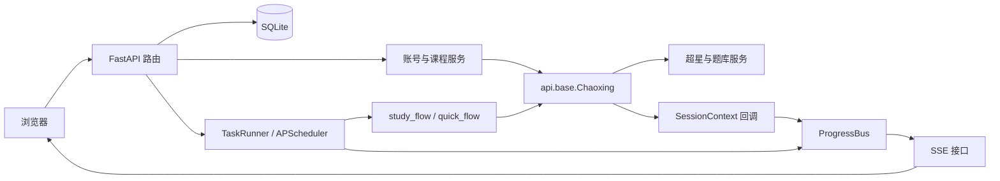

# 超星学习通 Web 控制台

通过浏览器管理学习通账号、选择课程、串行执行课程任务并查看实时进度。项目使用 FastAPI、SQLite、Jinja2 和 Alpine.js，提供管理员与普通用户控制台。

本文对应 `chaoxing-web` 版本，不提供原项目的 `main.py`、`config.ini` 或 `cookies.txt` 工作流。

> 管理员密码缺失或为空时，启动会初始化为 `admin123`，请登录后修改；已有密码会保留。任务调度器和实时事件总线都保存在进程内，当前应使用单进程运行。备份时需要同时保护数据库与加密密钥。

- [快速启动](#快速启动)
- [首次使用](#首次使用)
- [控制台功能](#控制台功能)
- [配置与运行](#配置与运行)
- [数据与备份](#数据与备份)
- [开发指南](#开发指南)
- [API 开发接口文档](docs/api.md)
- [按钮功能验收表](docs/ui-button-acceptance.md)
- [当前实现限制](#当前实现限制)

## 控制台功能

| 功能 | 当前行为 |
| --- | --- |
| 仪表盘 | 真实账号/任务/代理计数、最近 30 天趋势、任务队列和最新日志；日期按香港时间统计 |
| 新建任务 | 选择账号 → 选择课程 → 确认模式和参数 → 提交到串行调度器；空选择不会启动任务 |
| 账号与用户 | 添加账号、验证登录、创建平台用户、绑定/解绑账号和权限隔离 |
| 任务与日志 | SSE 实时进度、成功/失败/跳过分类、任务取消、全部日志搜索与分页 |
| 配置与运维 | 题库与代理来源配置、本地代理测试与启停、Git 在线更新和服务重启 |
| 页面交互 | 自适应导航、深浅主题切换、任务搜索；请求失败显示实际错误 |

管理员仪表盘汇总全量任务；普通用户仪表盘与任务搜索使用最近 100 条记录。代理可用率来自本地代理池记录，不代表每次请求一定成功。

## 快速启动

### 环境要求

- Python `>=3.13,<4.0`，版本约束见 [pyproject.toml](pyproject.toml)。
- 已安装 `uv`；安装依赖时需要访问 Python 包源。
- 调用课程接口时需要访问超星服务；启用题库后还需访问对应题库服务。
- 在线更新额外需要 Git、有效的 Git checkout 和 `origin` 远程仓库。

在 `chaoxing-web` 目录执行。Windows 使用 PowerShell，Linux/macOS 使用终端，命令相同：

```shell
cd chaoxing-web
uv sync --frozen
uv run python start.py --host 127.0.0.1
```

如果终端已位于 `chaoxing-web`，直接执行后两行。`--host 127.0.0.1` 只允许本机访问；省略该参数时默认监听 `0.0.0.0`。

| 入口 | 地址 | 用途 |
| --- | --- | --- |
| 首页 | `http://localhost:3000/` | 首页和普通用户入口 |
| 管理员登录 | `http://localhost:3000/admin/login` | 使用管理员密码登录 |
| 普通用户登录 | `http://localhost:3000/login` | 使用管理员开通的平台账号登录 |
| Swagger UI | `http://localhost:3000/docs` | 查看请求与响应模型 |
| ReDoc | `http://localhost:3000/redoc` | 浏览接口参考 |
| 健康检查 | `http://localhost:3000/healthz` | 返回 `{"status":"ok"}` |

### Docker 启动

在项目目录构建镜像并挂载运行数据：

```shell
docker build -t chaoxing-web .
docker run --name chaoxing-web -p 127.0.0.1:3000:3000 --mount type=volume,source=chaoxing-web-data,target=/app/data chaoxing-web
```

示例将端口发布到本机，数据库和密钥存入命名卷 `chaoxing-web-data`。现有 Dockerfile 固定使用 `--host 0.0.0.0 --port 3000`；调整宿主机端口时修改 `-p` 左侧端口，例如 `127.0.0.1:8080:3000`。

镜像按文件复制源码，没有 Git checkout 的常规镜像不能使用页面在线更新。更新容器时重新构建镜像并复用数据卷。

## 首次使用

1. 打开管理员登录页，使用首次初始化密码 `admin123` 登录。
2. 在「系统设置 → 密码」中修改管理员密码。
3. 在「学习通账号」中添加学习通手机号和密码。默认立即验证登录，成功后保存 Cookie；验证失败时账号仍保存，可查看错误后重新登录。
4. 如需普通用户访问，在「用户管理」中创建平台账号并绑定学习通账号。普通用户也可添加账号，新增账号归属于当前用户。
5. 按需配置题库和代理来源。学习任务固定串行，其他账号的任务按提交顺序排队。未配置题库时，章节检测不会自动作答；未配置自动提交时，后续章节可能无法解锁。
6. 点击「新建任务」，选择账号后进入课程页，选择课程、播放倍速和执行模式，再提交任务。
7. 在任务详情页查看日志、章节计数和播放进度；「任务日志」提供全部记录的搜索、级别筛选与分页。取消为协作式信号，实际终止可能需要等待当前请求或处理阶段结束。

管理员可以管理所有账号与任务。普通用户的账号列表、课程查询、任务列表、任务详情和 SSE 实时流按账号归属过滤。

### 任务模式

| 模式 | 行为 | 注意事项 |
| --- | --- | --- |
| `normal` | 按播放进度循环处理视频/音频任务 | 倍速范围为 `1.0`～`2.0` |
| `quick` | 对适用的视频/音频任务尝试快速上报完成进度 | 服务端未确认或遇到特定校验条件时回退正常模式，不保证缩短耗时 |

文档、阅读、章节检测和直播使用各自的底层处理流程。全部章节处理器返回成功时为 `completed`；有失败或跳过章节时为 `partial`（未全部完成）。任务详情分别显示成功、失败、跳过计数，处理进度仍包含全部已处理章节。成功统计反映处理器返回值，课程最终状态请在学习通确认。

## 配置与运行

### 启动参数

```shell
uv run python start.py --host 127.0.0.1 --port 8080
uv run python start.py --host 127.0.0.1 --reload --debug
```

也可使用等价入口 `uv run python -m webapp.run`。

| 参数 | 默认值 | 说明 |
| --- | --- | --- |
| `--host` | 环境变量或 `0.0.0.0` | 监听地址 |
| `--port` | 环境变量或 `3000` | HTTP 端口 |
| `--reload` | 关闭 | 开发热重载；重启会中断任务 |
| `--debug` | 关闭 | 开启调试日志并设置 `CHAOXING_DEBUG=true` |
| `--workers` | `1` | 只允许 `1`，拒绝多工作进程 |

### 环境变量

host/port 启动参数优先于同名环境变量。应用读取进程环境，当前没有自动加载 `.env` 的代码。

| 变量 | 默认值 | 说明 |
| --- | --- | --- |
| `CHAOXING_HOST` | `0.0.0.0` | 默认监听地址 |
| `CHAOXING_PORT` | `3000` | 默认端口 |
| `CHAOXING_DEBUG` | `false` | `1/true/yes` 开启应用调试；启动器日志级别由 `--debug` 控制 |
| `CHAOXING_MAX_ACCOUNTS` | 不再读取 | 学习任务固定串行；旧环境变量及数据库并发配置均不能开启并发 |
| `CHAOXING_COURSE_CACHE` | `300` | 课程列表内存缓存时间，秒 |

Windows 示例：

```powershell
$env:CHAOXING_PORT = "3000"
uv run python start.py --host 127.0.0.1
```

Linux/macOS 示例：

```bash
CHAOXING_PORT=3000 uv run python start.py --host 127.0.0.1
```

### 页面配置

| 配置 | 作用 | 生效时间 |
| --- | --- | --- |
| 题库 | provider、查询凭据、覆盖率、保存/提交策略 | 新任务读取 |
| 代理 | 手动列表、本地池或 SCDN 动态来源，随机或按编号选择 | 后续登录、课程查询及新任务读取 |
| 运行 | 展示固定串行策略，一次一个账号、一个任务点 | 始终生效，不能调高 |
| 通知（仅兼容 API） | 保存 provider 和目标地址 | 尚未接入推送流程，页面不提供操作入口 |

题库 provider 按类名填写：`TikuYanxi`、`TikuLike`、`TikuAdapter`、`AI` 或 `SiliconFlow`；空字符串禁用。字段见 [API 文档](docs/api.md#题库配置)。`submit=false` 只保存搜到的答案；`submit=true` 按覆盖率决定是否提交，覆盖率不代表正确率。

本地代理添加时测试连通性，通过后入池；默认检测超星入口及登录接口。批量复测会更新可用状态。手动启用不会重新测试，`failover` 当前没有自动切换逻辑，因此页面移除了该开关。

### 控制台操作

- “新建任务”进入账号选择页，再选择课程、确认参数并提交到实际调度器；空课程选择不会启动任务。
- “任务日志”和“查看全部”进入独立日志页，支持数据库分页、内容/账号搜索和级别筛选；普通用户只查看自己账号的日志。
- 设置保存、账号管理、用户绑定、代理管理、任务取消和更新均调用对应 API；HTTP 错误、业务拒绝及网络失败会显示实际错误，失败不跳转或显示成功。
- 页面不提供未实现的通知推送、代理自动失败切换、锁定章节回退重试/询问选项。锁定章节会记录跳过结果。

### 在线更新

管理员在「更新」页面检查版本。应用访问 `origin/<当前分支>`，工作区存在未提交修改时拒绝更新。执行过程为：

```text
git pull --ff-only origin <当前分支>
uv sync
```

`<当前分支>` 由更新器读取 checkout 的分支名。更新后需重启；代码已拉取但依赖同步失败时，返回部分更新状态。重启不会续跑原任务。

## 数据与备份

运行数据目录固定为项目根目录下的 `data/`，不随终端工作目录变化。

| 文件 | 内容 | 恢复要求 |
| --- | --- | --- |
| `data/chaoxing.db` | 用户、账号、Cookie、任务、日志、代理和配置 | 与加密密钥一起备份 |
| `data/.secret_key` | 学习通密码的 Fernet 加密密钥 | 丢失后无法解密原有密码 |
| `data/.session_secret` | 浏览器 Session 签名密钥 | 更换会使已有会话失效 |
| `data/chaoxing.log` | 底层运行日志，按 10 MB 轮转 | 按需保留，用于排查问题 |

平台密码使用 PBKDF2-SHA256 哈希；学习通密码使用可逆 Fernet 加密，以便登录。Cookie 和题库 token/key 直接存入数据库，未使用同样的字段加密。

备份前停止服务，再复制整个 `data/`；恢复时停止服务并恢复成套数据。启动初始化保留已有管理员密码，即使旧库没有迁移标记也不会重置；只有缺失或空密码才初始化默认值。

启动会为旧任务表补充成功、失败、跳过字段，初始值为 0，并保留原任务状态和已处理数。无法从旧计数可靠还原分类，页面将差额显示为「历史未分类」，不会猜测成功数。

题库答案缓存另存为当前工作目录的 `cache.json`。不要提交运行数据、Cookie、密钥或真实凭据。

## 开发指南

### 目录结构

```text
chaoxing-web/
├── start.py                 启动参数与 Uvicorn 入口
├── pyproject.toml           Python 版本约束与依赖
├── uv.lock                  锁定依赖
├── api/                     超星接口、解析、题库、会话上下文
├── resource/                字体映射资源
├── webapp/
│   ├── server.py            FastAPI 应用与生命周期
│   ├── config.py            环境配置、路径和密钥
│   ├── db.py                数据库 Session 与轻量迁移
│   ├── deps.py              登录和管理员鉴权依赖
│   ├── models/              SQLAlchemy 模型
│   ├── schemas/             Pydantic 请求/响应模型
│   ├── routers/             页面和 HTTP API
│   ├── services/            账号、调度、进度、代理、更新服务
│   ├── templates/           Jinja2 页面与 Alpine.js 状态
│   └── static/              CSS 和原生 JavaScript
├── tests/                  临时数据库、权限、调度和前端回归
└── docs/
    ├── api.md               HTTP API、SSE 与后端扩展约定
    ├── acceptance-2026-10-09.md  权限、初始化、结果统计与串行验收
    └── ui-button-acceptance.md   控制台操作验收与验证范围
```

前端由服务端渲染，无独立 Node.js 构建步骤。Alpine.js 和字体通过外部 CDN 加载，离线部署时需另行处理这些资源。

### 调用关系



路由使用异步数据库 Session，后台学习任务在一个工作线程中按提交顺序执行，使用同步 Session。每个账号使用独立 `requests.Session`；普通/快速模式中的章节任务点及直播处理均在当前任务线程内依次执行，沿用会话、进度回调和取消信号。

扩展接口、任务类型或题库时，参照 [API 文档中的后端扩展约定](docs/api.md#后端扩展约定)。

### 回归测试

在项目目录执行，不需要额外安装 pytest：

```shell
uv run python -m unittest discover -s tests -t . -v
```

测试使用临时数据库，模拟外部登录、课程查询和代理连通性，不启动真实课程任务。覆盖权限隔离、管理员初始化、串行调度、任务分类计数、旧库迁移、终态事件、日志筛选/分页，以及账号、用户、配置和代理的真实数据库操作；Node.js 可用时还验证页面事件处理器，未安装时该项会显示跳过。

安装 Node.js 后可单独验证前端请求与失败反馈，无需安装 npm 依赖：

```shell
node tests/ui_actions.cjs
```

2026-10-09 验收：67 项 Python 回归通过，前端脚本覆盖 19 条管理操作失败路径及课程选择、取消、退出和重启反馈。验证的是本地接口、调度和数据库行为；外部平台的最终结果仍需用有效账号及网络实际确认。详细范围见[按钮功能验收表](docs/ui-button-acceptance.md)。

## 当前实现限制

- `jobs` 作为兼容字段仅接受 `1`；账号、章节和章节任务点均串行执行。旧任务保存的 jobs 值不改变执行策略。排队任务不会因为等待超过 60 秒被调度器丢弃。
- `notopen_action` 接受 `retry/ask/continue`，当前主要影响日志，未落实 CLI 的回退重试或询问流程。
- `done_chapters` 表示已处理数，成功、失败、跳过使用独立字段。旧任务仍保留原状态，未分类的历史结果不回填。
- 重启时遗留的 `pending/running` 任务会标记为 `cancelled`，不会自动恢复。
- 调度器、取消信号、缓存和 SSE 总线在进程内；两个启动入口只允许单 worker。应只运行一个服务实例，独立实例之间没有全局协调。
- 通知配置未接入任务结束流程，代理 `failover` 未实现自动切换。
- 不自动读取 `.env`；健康检查只表示 HTTP 应用可响应，不验证数据库、路由完整性或调度器。

## 常见问题

| 现象 | 排查方式 |
| --- | --- |
| 提示缺少依赖 | 在项目目录运行 `uv sync --frozen`，再用 `uv run` 启动 |
| 端口被占用 | 使用 `--port 8080`；Docker 修改宿主机映射端口 |
| 学习通登录失败 | 查看账号 `last_error`，检查凭据、Cookie 和代理连通性 |
| 旧并发配置未生效 | 当前固定串行执行，不允许通过环境变量、旧配置或请求参数开启并发 |
| 显示未全部完成 | 查看失败/未开放日志，以及成功、失败、跳过分类计数 |
| 历史任务显示未分类 | 旧计数无法可靠拆分，保留原记录；新任务提供分类统计 |
| 重启后任务取消 | 这是当前恢复策略，需要重新创建任务 |
| 在线更新被拒绝 | 检查未提交修改、分支、Git 和 uv 是否可用 |

## 许可证与来源

项目复用原超星项目的接口与任务处理代码，来源为 [Samueli924/chaoxing](https://github.com/Samueli924/chaoxing)。许可证见 [LICENSE](LICENSE)。
